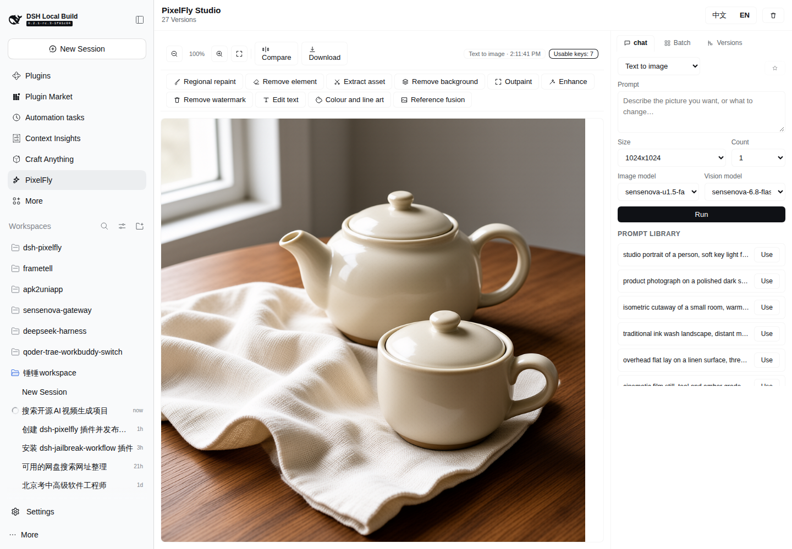
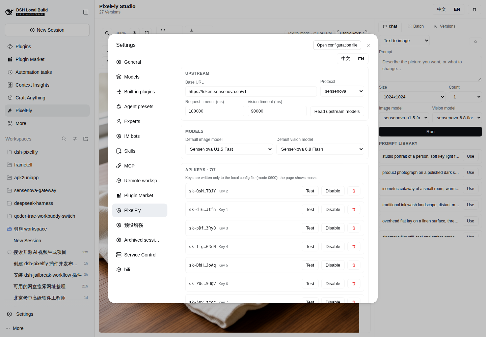
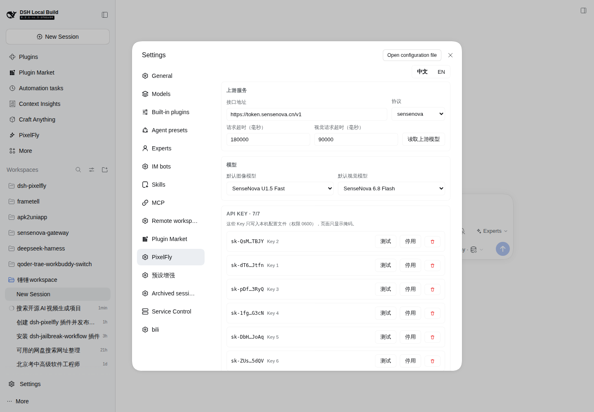

# dsh-pixelfly

An image studio for **DeepSeek Harness**. Pixelfly turns a prompt into a picture, then lets you keep
working on it — repaint a region, remove something, replace the background, change the text on a
sign, extend the canvas — and keeps every result as a step in one version tree you can compare and
revisit.

Everything is configured in the Harness UI. There are no environment variables to set and no config
file to hand-edit.

## Screenshots





Both surfaces ship in Chinese and English; the toggle is in the top-right of each page.



## What it does

One workspace, one history. There is no library of projects to manage: every run becomes a version
whose parent is the picture you were working on, so the tree shows how a picture evolved and any
node can be reopened or compared with another.

The toolbar has ten operations:

| Operation | What it needs | What it does |
| --- | --- | --- |
| **Text to image** | prompt | Draws a new picture. |
| **Prompt edit** | prompt | Repaints the whole picture from an instruction. |
| **Regional repaint** | selection + prompt | Redraws only the area you drag over. |
| **Remove element** | boxes + preset | Erases clutter, passers-by, text or a stray object, optionally protecting boxes you keep. |
| **Extract asset** | box + kind | Lifts one object out onto a clean white catalogue background. |
| **Remove background** | — | Cuts the subject out to transparency. |
| **Outpaint** | new size | Grows the canvas and paints the new area. |
| **Enhance** | strength | Sharpens detail and light at three strengths. |
| **Remove watermark** | box (optional) | Finds a watermark with the vision model, or uses your box, and rebuilds what was underneath. |
| **Edit text** | regions | Reads the text in the picture, then replaces or clears any region of it. |
| **Colour and line art** | mode | Recolours a picture, or turns it into line art and back. |
| **Reference fusion** | reference + prompt | Puts a subject from a reference picture into this one, or dresses, poses or groups it. |
| **Batch** | prompt list or variables | Runs many prompts, or every combination of `[variable]` values, as separate versions. |

Selecting a region is a drag on the picture; the selection stays as percentages so it still means the
same thing whatever size the model answers with.

## How a regional edit stays seamless

A model asked to "change only this box" of a full frame tends to paint that box as its own little
picture, with its own backdrop and lighting, and the result reads as a rectangle pasted on. Pixelfly
sends a **padded crop** instead — real surrounding pixels sit right against the area to change, and
models continue what they can see — then pastes back only the part of the answer that lines up with
the selection, corrects its colour against the border ring, and feathers it in with a smoothstep
ramp.

## Keys and retries

- **A ring of API keys.** Requests rotate round-robin. A rejected key (`401`/`402`/`403`) is cooled
  down and the *next* attempt uses a different key, so one bad key never aborts a run.
- **Exponential backoff with jitter** on `429`/`5xx` and network errors, capped by a configurable
  ceiling, honouring `Retry-After` when the upstream sends one.
- **Nothing is written to logs.** Keys live in a `0600` file under the Harness data directory and the
  UI only ever receives a mask such as `sk-a1b2…z9y8`.

## Models

Two roles, both configurable:

- **Image model** — the one that draws. Tuned and tested with the SenseNova image models
  `sensenova-u1.5-fast` and `sensenova-u1.5-lite`; any OpenAI-compatible image endpoint works.
- **Vision model** — the one that looks. Used to plan a repaint, find a watermark, name the subject
  for background removal, and read text in a picture. Defaults to the SenseNova chat models.

The pickers are driven by the configured lists rather than by the upstream catalogue, because a
catalogue can omit a model that still answers requests.

## Agent tools

The model can drive the studio mid-conversation:

| Tool | Purpose |
| --- | --- |
| `pixelfly_generate` | Draw a picture from a prompt. |
| `pixelfly_edit` | Any of the edit operations above, against the current picture or a given version. |
| `pixelfly_history` | List, inspect, star, delete or clear versions; set the workspace style. |
| `pixelfly_config` | Read or change the upstream, keys, retry policy and defaults. |
| `pixelfly_status` | Keys, versions, sizes and the operation catalogue. |

## Install

```bash
# from the profile you want the plugin in
dsh plugin --profile web add file:/path/to/dsh-pixelfly
```

Then open **Settings → PixelFly**, paste your upstream base URL and at least one API key, and press
**Test** next to a key to confirm it works.

## Data

Everything lives under the Harness data directory:

```
$DSH_HOME/plugins-data/pixelfly/
  config.json     upstream, keys (0600), retry policy, defaults
  history/        the workspace record: versions and conversation
  assets/         every picture, content-addressed by SHA-256
  library.json    saved prompts
```

Delete the folder to start over; nothing else on the machine is touched.

## Licence

MIT.
